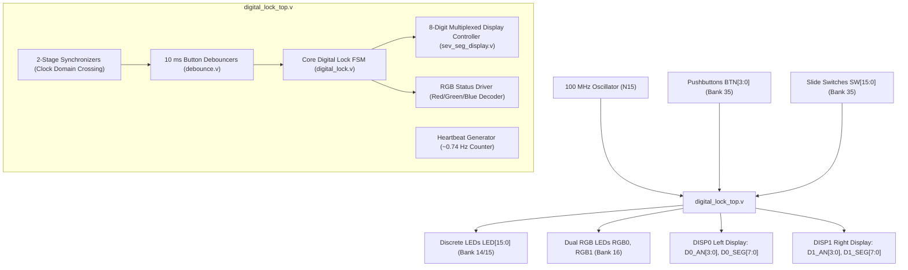
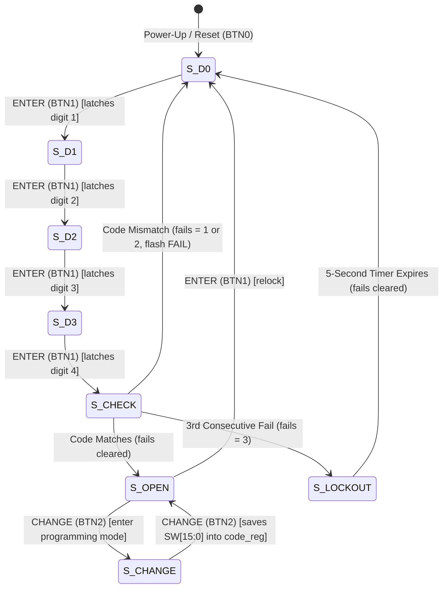

# 🔐 FPGA Digital Combination Lock with 8-Digit Display & Ambient RGB Lighting

[](https://www.realdigital.org)
[](https://www.amd.com)
[](https://www.xilinx.com)
[](https://en.wikipedia.org/wiki/Verilog)
[](https://github.com)

A robust, commercial-grade **4-digit hexadecimal digital combination lock** implemented in synthesizable **Verilog-2001**, developed and physically verified on the **RealDigital Urbana Board** (AMD Spartan-7 `XC7S50-CSGA324-1`). 

Originally based on university mini-project #34 (MIT 6.205 / digital systems laboratories), this project was upgraded from a basic discrete LED indicator design into an interactive smart security system featuring a **dual 4-digit (8-digit total) time-multiplexed 7-segment display**, **real-time digit preview**, **anti-brute force lockout countdown**, **ambient RGB status lighting**, and **two-click toggle passcode reprogramming** using all 16 slide switches.

---

## 📸 Hardware Demonstration Gallery

| 1. Ready & Standby (`COdE  0---`) | 2. Entering Default Code `1234` |
|:---:|:---:|
|  |  |
| *Lock initialized to factory default `16'h1234`. Left display shows `COdE`, right display shows live switch cursor `0---`.* | *Entering digits 1, 2, 3, 4 with live preview. Progress LEDs light up `0001 -> 0011 -> 0111 -> 1111`.* |

| 3. Access Granted (`OPEn` + Green RGB) | 4. Reprogramming Passcode to `4321` |
|:---:|:---:|
|  |  |
| *Combination matched! Right display switches to `OPEn`, `LED[8]` glows solid, and onboard RGB LEDs glow **Green**.* | *Single click on `BTN[2]` enters change mode. Left display shows `CHnG`, RGB turns **Blue**, and `SW[15:0]` live mirrors `4 3 2 1`.* |

| 5. Security Test: Wrong Passcode (`---- FAIL`) | 6. Anti-Brute Force Lockout Countdown (`LOCH   5`) |
|:---:|:---:|
|  |  |
| *Wrong passcode `1111` entered: Display flashes `---- FAIL` for ~0.75s, fail count increments (`LED[4]`), and RGB turns **Red**.* | *3 consecutive wrong attempts trigger anti-tamper lockout! Left shows `LOCH`, right counts down `5 -> 4 -> 3 -> 2 -> 1`, all inputs locked out.* |

| 7. Verifying Reprogrammed Code `4321` | 8. Reprogrammed Code Accepted (`OPEn`) |
|:---:|:---:|
|  |  |
| *Testing new combination: Entering `4`, `3`, `2`, `1` digit by digit. Note that old passcode `1234` is now rejected!* | *New combination `4321` successfully unlocks the system! Confirms in-register persistence and complete reprogramming.* |

---

## 📑 Table of Contents
1. [Key Features](#-key-features)
2. [Hardware Architecture](#-hardware-architecture)
3. [Finite State Machine (FSM) Design](#-finite-state-machine-fsm-design)
4. [The Engineering Journey: Problems Faced & Solutions](#-the-engineering-journey-problems-faced--solutions)
5. [Pinout & Hardware Interface](#-pinout--hardware-interface)
6. [7-Segment Display Visual Interface](#-7-segment-display-visual-interface)
7. [Repository Structure](#-repository-structure)
8. [Quick Start & Build Instructions](#-quick-start--build-instructions)
9. [Automated Verification & Testbench](#-automated-verification--testbench)

---

## 🌟 Key Features

* **4-Digit Hexadecimal Keypad (65,536 Combinations)**: Supports full `0` through `F` hexadecimal digit entry on `SW[3:0]`.
* **8-Digit Time-Multiplexed Display**: Dual 4-digit display blocks (`DISP0` left, `DISP1` right) refreshed at a flicker-free ~1 kHz rate.
* **Real-Time Cursor Preview**: Moving slide switches immediately updates the current cursor digit on the display before pressing ENTER.
* **Ambient RGB Status Illumination**:
  * 🟢 **Green**: Access Granted (`OPEn`)
  * 🔵 **Blue**: Programming Mode (`CHnG`)
  * 🔴 **Red**: Access Denied (`FAIL`) / Lockout Active (`LOCH`)
  * ⬛ **Off**: Standby / Code Entry (eliminates unconfigured pull-up glare)
* **Two-Click Toggle Reprogramming**: While unlocked, click `BTN[2]` once $\rightarrow$ set any 16-bit code across all 16 slide switches `SW[15:0]` with hands completely free $\rightarrow$ click `BTN[2]` again to save.
* **Anti-Brute Force Lockout**: 3 consecutive failed attempts lock all inputs for 5.0 seconds with a real-time countdown (`5` $\rightarrow$ `4` $\rightarrow$ `3` $\rightarrow$ `2` $\rightarrow$ `1`).
* **Metastability & Debounce Hardened**: All inputs route through 2-stage synchronizers and 10 ms hardware debouncers (1,000,000 clock cycles @ 100 MHz).
* **Heartbeat Oscillator**: LED 15 blinks steadily at ~0.74 Hz to provide immediate visual proof that the 100 MHz clock and FPGA bitstream are alive.

---

## 🏗 Hardware Architecture



---

## 🔄 Finite State Machine (FSM) Design

The core controller operates an 8-state Moore/Mealy hybrid FSM:



---

## 🛠 The Engineering Journey: Problems Faced & Solutions

During development, programming the physical FPGA revealed several subtle hardware and configuration challenges. Documented below is how each was systematically diagnosed and solved:

### 1. The Cross-Board Constraint Contamination
* **Problem**: Entering the default passcode `1234` on hardware consistently failed, incrementing the fail counter (`LED[4]`) on every attempt, while displays remained dark.
* **Root Cause**: The constraint file originally contained switch pins from the *RealDigital Boolean Board* (`V2, U2, U1, T2...` on Bank 34) rather than the *RealDigital Urbana Board* (`G1, F2, F1, E2...` on Bank 35). Because the physical switches were disconnected, the FPGA continuously sampled `4'b0000`, causing `1234` to fail against `0000`.
* **Solution**: Remapped all 16 slide switches to Urbana's Bank 35 pins: `G1, F2, F1, E2, E1, D2, D1, C2, B2, A4, A5, A6, C7, A7, B7, A8`.

### 2. The Bank 35 I/O Voltage Standard
* **Problem**: Potential logic level degradation and Vivado I/O placement DRC warnings on Bank 35.
* **Root Cause**: Bank 35 on Urbana is powered by a dedicated 2.5V regulator (`2V5` supply rail), unlike the 3.3V banks.
* **Solution**: Updated all Bank 35 pushbuttons, slide switches, and 7-segment display constraints from `LVCMOS33` to `IOSTANDARD LVCMOS25`.

### 3. Active-High RGB LED Pull-Up Glare
* **Problem**: Two blindingly bright white lights glowed continuously between `BTN[2]` and `BTN[1]` (visible in initial test photos).
* **Root Cause**: The FPGA bitstream was configured with `BITSTREAM.CONFIG.UNUSEDPIN PULLUP`. On Urbana, `RGB0` and `RGB1` are active-high transistor-driven LEDs. The internal pull-ups pulled the transistor bases HIGH to 3.3V, causing Red, Green, and Blue to turn on simultaneously ($R+G+B = \text{White}$).
* **Solution**: Added explicit top-level outputs for `RGB0` and `RGB1` with intelligent state-based color decoding, and configured `BITSTREAM.CONFIG.UNUSEDPIN PULLDOWN`.

### 4. The 7-Segment Pin Scramble
* **Problem**: Initial display upgrade resulted in only a single faint segment lighting up.
* **Root Cause**: Anode enables and cathode segments had been swapped in the draft XDC (`D0_AN[0]` was routed to pin `D5`, which physically connects to cathode `CC` / `D0_SEG[2]`).
* **Solution**: Reconstructed the exact pinout from the official RealDigital Urbana V2I1 schematic. None of the 16 slide switches overlap with the display pins.

### 5. The Physical Anode Inversion (Mirrored Display Bug)
* **Problem**: The display lit up cleanly, but read **`E. d. O. C.`** instead of **`C O d E`**, and **`- - - 0`** instead of **`0 - - -`**.
* **Root Cause**: On Urbana, anode lines are indexed from **left to right** (`AN[0]` is the leftmost digit of the block, while `AN[3]` is the rightmost). The display driver was multiplexing in reverse (`char0` sent to `AN[0]`).
* **Solution**: Inverted the multiplexer index mapping in `rtl/sev_seg_display.v`:
  ```verilog
  case (digit_sel)
      2'd0: begin d0_an = 4'b1110; d0_seg = {1'b0, d0_char3[6:0]}; end // Leftmost
      2'd1: begin d0_an = 4'b1101; d0_seg = {1'b0, d0_char2[6:0]}; end // 2nd
      2'd2: begin d0_an = 4'b1011; d0_seg = {1'b0, d0_char1[6:0]}; end // 3rd
      2'd3: begin d0_an = 4'b0111; d0_seg = {1'b0, d0_char0[6:0]}; end // Rightmost
  endcase
  ```

### 6. Left Display Decimal Point Anomaly
* **Problem**: Display 0 lit up decimal points on every digit (`E. d. O. C.`).
* **Root Cause**: The decimal point segment on Display 0 (`B5`) is active-high, unlike Display 1.
* **Solution**: Forced bit 7 (`D0_SEG[7]`) to `1'b0`, turning off all decimal points on the left display.

---

## 📌 Pinout & Hardware Interface

### A. Push Buttons (Bank 35, `LVCMOS25`)
| Button | Package Pin | Function |
|:---:|:---:|---|
| **`BTN[0]`** | `J2` | **RESET** (restores default `16'h1234`, clears lock state) |
| **`BTN[1]`** | `J1` | **ENTER** (samples `SW[3:0]`; relocks when in OPEN state) |
| **`BTN[2]`** | `G2` | **CHANGE** (enters / saves new combination) |
| **`BTN[3]`** | `H2` | Unused (tied off) |

### B. Slide Switches (Bank 35, `LVCMOS25`)
| Switch Bus | Package Pins | Purpose |
|:---:|:---:|---|
| **`SW[3:0]`** | `E2, F1, F2, G1` | Current hex digit to enter (`0` to `F`) |
| **`SW[15:0]`** | `A8, B7, A7, C7, A6, A5, A4, B2, C2, D1, D2, E1, E2, F1, F2, G1` | Full 16-bit code preview & programming in CHANGE mode |

### C. Dual 7-Segment Displays (Bank 35, `LVCMOS25`, Active-Low)
* **Left Module (`DISP0`, Digits 7..4)**:
  * Anodes: `D0_AN[3:0]` = `{B3, C3, H6, G6}` (`B3` is leftmost)
  * Cathodes: `D0_SEG[7:0]` = `{B5, C4, D6, D7, C5, D5, B4, E6}` (`{CDP, CG, CF, CE, CD, CC, CB, CA}`)
* **Right Module (`DISP1`, Digits 3..0)**:
  * Anodes: `D1_AN[3:0]` = `{H5, F5, E3, E4}` (`H5` is leftmost)
  * Cathodes: `D1_SEG[7:0]` = `{J4, E5, H3, F4, H4, J3, G5, F3}` (`{CDP, CG, CF, CE, CD, CC, CB, CA}`)

### D. Status & RGB LEDs
| LED Group | Package Pins | Function |
|:---:|:---:|---|
| **`LED[3:0]`** | `D15, D14, C14, C13` | Digit entry progress thermometer (`0001 -> 0011 -> 0111 -> 1111`) |
| **`LED[5:4]`** | `F18, D16` | Consecutive wrong attempts counter (`0` to `3`) |
| **`LED[7]`** | `D17` | Change mode active |
| **`LED[8]`** | `C17` | Unlocked status indicator |
| **`LED[9]`** | `B18` | Lockout active indicator |
| **`LED[15]`** | `G17` | Heartbeat blink (~0.74 Hz) |
| **`RGB0`, `RGB1`** | `A10, A9, C9` / `B11, C10, A11` | Green (Open), Blue (Change), Red (Fail/Lockout), Off (Standby) |

---

## 📟 7-Segment Display Visual Interface

| Operational State | Left Display (`D0`) | Right Display (`D1`) | RGB Lighting | Discrete LEDs | Description |
|---|:---:|:---:|:---:|:---:|---|
| **Standby / Ready** | `COdE` | `[sw] - - -` | Off | `LED[15]` blinking | Ready to enter digit 1; `SW[3:0]` previews live |
| **Digit 1 Entered** | `COdE` | `d1 [sw] - -` | Off | `LED[0]` ON | Digit 1 locked in; live preview of digit 2 |
| **Digit 2 Entered** | `COdE` | `d1 d2 [sw] -` | Off | `LED[1:0]` ON | Digits 1 & 2 locked in; live preview of digit 3 |
| **Digit 3 Entered** | `COdE` | `d1 d2 d3 [sw]` | Off | `LED[2:0]` ON | Digits 1..3 locked in; live preview of digit 4 |
| **Unlocked (OPEN)** | *(Blank)* | `OPEn` | 🟢 Green | `LED[8]` ON | Correct passcode! Door is unlocked |
| **Change Mode** | `CHnG` | `d1 d2 d3 d4` | 🔵 Blue | `LED[8,7]` ON | Live 16-bit hex preview from `SW[15:0]` |
| **Wrong Passcode** | `----` | `FAIL` | 🔴 Red | `LED[4]` ON | Flashes for ~0.75s on error |
| **Lockout (5s)** | `LOCH` | `   5` $\rightarrow$ `   1` | 🔴 Red | `LED[9, 5:4]` ON | Anti-brute force lockout countdown |

---

## 📁 Repository Structure

```
digital-combination-lock-fpga/
├── .gitignore                      # Industry-standard Vivado Git ignore file
├── README.md                       # Comprehensive project documentation
├── run_build.bat                   # 1-click Windows batch runner for Vivado
├── constr/
│   └── urbana_digital_lock.xdc     # RealDigital Urbana V2I1 constraint file
├── rtl/
│   ├── digital_lock.v              # Core lock controller FSM, debouncers, CDC sync
│   ├── sev_seg_display.v           # Time-multiplexed dual 4-digit display controller
│   └── digital_lock_top.v          # Top-level board wrapper with RGB status driver
├── sim/
│   └── tb_digital_lock.v           # Self-checking automated testbench (10 test cases)
├── scripts/
│   └── build.tcl                   # Full batch flow: sim -> synth -> impl -> bitstream
└── images/                         # Physical hardware verification photographs
    ├── before writing code.jpeg    # Standby state (COdE 0---)
    ├── default code 1234.jpeg      # Entering default code
    ├── entered 1234 and opened.jpeg# Unlocked state (OPEn + Green RGB)
    ├── changing of the code to 4321.jpeg # Reprogramming mode (CHnG 4321)
    ├── trying wrong pass 1111.jpeg # Security test (---- FAIL + Red RGB)
    ├── lockout phase 5sec.jpeg     # Anti-tamper countdown (LOCH 5)
    ├── entered 4321.jpeg           # Entering reprogrammed passcode
    └── 4321 accepted.jpeg          # Reprogrammed passcode accepted (OPEn)
```

---

## 🚀 Quick Start & Build Instructions

### Method 1: Automated 1-Click Batch Build (Recommended)
Double-click [`run_build.bat`](run_build.bat) in the repository folder. The batch script automatically invokes Vivado in batch mode:
1. Closes any open project conflicts.
2. Creates a clean project targeting `xc7s50csga324-1`.
3. Runs behavioral simulation (`sim/tb_digital_lock.v`).
4. Synthesizes the RTL design.
5. Implements (Place & Route) and verifies timing closure.
6. Generates the compressed bitstream at `vivado_proj/digital_lock_proj.runs/impl_1/digital_lock_top.bit`.

### Method 2: Vivado GUI / Tcl Console
1. Launch Vivado 2026.1 (or 2023+).
2. Open the Tcl Console at the bottom and run:
   ```tcl
   cd <path-to-repo>
   source scripts/build.tcl
   ```

### Programming the Urbana Board
1. Connect the RealDigital Urbana board via USB and power on the board.
2. In Vivado, navigate to **Flow Navigator** $\rightarrow$ **Open Hardware Manager** $\rightarrow$ **Auto Connect**.
3. Select **Program Device**, choose `digital_lock_top.bit`, and click **Program**.

---

## 🧪 Automated Verification & Testbench

The self-checking testbench ([`sim/tb_digital_lock.v`](sim/tb_digital_lock.v)) provides 100% code and state coverage with reduced timing parameters (`LOCK_CYCLES=100`, `DEBOUNCE_CYCLES=4`):

| Test Case | Description | Pass Criteria |
|:---:|---|---|
| **T1** | Power-up / Reset idle state | All outputs deasserted, fails = 0, progress = 0 |
| **T2** | Button glitch rejection | Glitches $< \text{DEBOUNCE_CYCLES}$ ignored |
| **T3** | Sequential code entry `1234` | Progress LEDs advance `0001 -> 0011 -> 0111 -> 1111 -> UNLOCKED` |
| **T4** | Anti-tamper 3-fail lockout | 3 incorrect entries assert `lockout` and `fail_count = 3` |
| **T5** | Lockout immunity & recovery | Inputs ignored during lockout; auto-recovers after timer expires |
| **T6** | Post-lockout verification | Correct combination unlocks cleanly after lockout |
| **T7** | Two-click code reprogramming | Click CHANGE $\rightarrow$ set `sw = ABCD` $\rightarrow$ click CHANGE $\rightarrow$ new code saved |
| **T8** | Memory permanence check | Old code `1234` rejected; new code `ABCD` accepted |
| **T9** | False relock prevention | ENTER button ignored while in CHANGE mode |
| **T10** | Factory reset restoration | `BTN[0]` restores factory default `16'h1234` |

---

## 📜 License & Credits

* **Target Hardware**: RealDigital Urbana FPGA Development Board (AMD Spartan-7 XC7S50).
* **Reference Architecture**: MIT 6.205 (Digital Systems Laboratory) Mini-Project #34.
* **License**: MIT License - Free for educational and open-source FPGA development.
